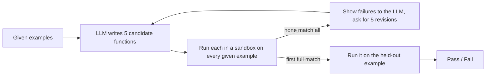

# example-driven-transforms

**Can an LLM that writes whole Python functions, checked only by running them, handle Flash Fill-style text transformation without a hand-built DSL? A one-day experiment, with results.**

> **TL;DR.** I tested whether a plain generate, rank, iterate loop around an LLM can infer a string transformation from input/output examples, with no domain-specific language. On a seeded sample of 30 tasks from the public PROSE benchmark suite (`Transformation.Text`), the chosen program got the held-out example right on **28 of 30 tasks (93%)**. Both misses were tasks where no candidate ever fit all the given examples. Every candidate that did fit them (126 across 28 tasks) also got the held-out example right. The sample is small, mostly synthetic, and gives about ten examples per task, so read the number with the caveats [below](#evaluation-and-what-the-number-does-not-say).



## Why

I wanted to find out whether an LLM alone, without a hand-built domain-specific language, could handle the kind of example-driven text transformation Flash Fill does in Excel. So I built a small generate-and-rank solver to test it.

## One task, start to finish

Task `Author.000001` asks for a year from a messy date column. These are the 15 examples the model saw, out of 30 distinct given examples:

```text
"Living"          -> "2016"        "9-Jun-73"        -> "1973"
"6-Apr-92"        -> "1992"        "5 December 1870" -> "1870"
"1 December 1848" -> "1848"        "6-Nov-62"        -> "1962"
"1984"            -> "1984"        "1-Mar-20"        -> "2020"
"28-Nov-68"       -> "1968"        "1111"            -> "1111"
"2-Dec-65"        -> "1965"        "24-Dec-61"       -> "1961"
"21-May-00"       -> "2000"        "8 November 1240" -> "1240"
"16-Aug-04"       -> "2004"
```

**Round 0.** The model returned five candidates built on regex, split, strptime, and explicit cases. All five were rejected. This split-based one was the closest:

```python
def transform(x):
    if not x: return None
    parts=[p for p in x.replace('-', ' ').split() if p.isdigit()]
    if not parts: return "2016"
    token=parts[-1]
    if len(token)==4: return token
    if len(token)==2:
        y=int(token)
        return str(1900+y) if y>=50 else str(2000+y)
    return token
```

It matches all 15 examples above. It fails on two given examples the model never saw: `27-Nov-40` should be `1940` (it returned `2040`), and `17-Jun-43` should be `1943`. All five candidates had guessed the same century cutoff at 50.

**Round 1.** Those two failures went back to the model word for word. The first candidate that fit all 30 given examples was:

```python
import re

def transform(x):
    if not x:
        return None
    tokens = [t for t in re.split(r'[-\s]', x) if t.isdigit()]
    if not tokens:
        return "2016"
    t = tokens[-1]
    if len(t) == 4:
        return t
    if len(t) == 2:
        y = int(t)
        return str(2000 + y) if y <= 30 else str(1900 + y)
    return None
```

The same round also contained a rejected candidate that shows a different failure mode. It removed month names with `re.sub(r'(?i)\\b' + name + r'\\b', '', s)`. Inside a raw string, `\\b` matches a literal backslash followed by `b`, not a word boundary, so every input fell through to its `"2016"` fallback, which is wrong for 29 of the 30 examples. More on that [below](#4-across-the-run-code-inside-json).

**Held-out.** `"30-Jun-02"` was expected to give `"2002"`, and the chosen function returned `"2002"`. **Pass.**

The cutoff the model settled on (30) is still a guess. The given examples put `00`–`20` in the 2000s and `40`–`99` in the 1900s, so a two-digit year from 21 to 39 could go either way. The held-out year `02` doesn't test that range.

## Results

On a sample of 30 tasks (seed 42): **28/30 passed (93.3%)**. The full summary is in [`results/summary.md`](results/summary.md) and per-task records are in [`results/results.json`](results/results.json).

| Round a candidate fit all given examples | Tasks | Passed held-out |
|---|---:|---:|
| 0 (first generation) | 27 | 27 |
| 1 (first revision) | 1 | 1 |
| never | 2 | 0 |

Accuracy by feature tag. Tasks carry several tags and count toward each one, so rows overlap and small rows mean little.

| Feature | Tasks | Passed | Accuracy |
|---|---:|---:|---:|
| DateTime | 15 | 13 | 86.7% |
| Substring | 11 | 11 | 100.0% |
| DateTimeRounding | 7 | 7 | 100.0% |
| DateTimeRange | 5 | 5 | 100.0% |
| Conditional | 3 | 3 | 100.0% |
| Multicolumn | 3 | 3 | 100.0% |
| Numeric | 3 | 3 | 100.0% |
| Concatenation | 2 | 2 | 100.0% |
| NumericRounding | 2 | 2 | 100.0% |

What stands out:

- **Fitting the given examples was the whole game.** Once a candidate fit every given example, it also got the held-out one right: 126 of 126 surviving candidates did. No task fit the examples and then failed the held-out one.
- **Most tasks were solved immediately.** 123 of the 148 first-round candidates survived, and only 3 tasks needed a revision round.
- **Cost.** 35 LLM requests in total: 27,410 prompt tokens and 95,732 completion tokens, most of the completion tokens being the model's hidden reasoning.

## How it works

**Split.** For each task, every example except the last is *given*. The last one is *held out*. The model never sees it, and it is used exactly once, after a candidate has been chosen.

**Generate.** The prompt shows the given examples, JSON-encoded so stray spaces and quotes are visible, along with the function signature. It asks for 5 candidates that take different approaches: regex, split/join, slicing, parse-and-reformat, explicit cases. The reply is a JSON object holding a list of source strings. Most tasks have 15 or fewer distinct given examples, and all of them go in the prompt. For the 10 tasks in this sample that had more (up to 99), the prompt shows the first 15.

**Rank by execution.** Each candidate runs against *every* given example, including ones that weren't in the prompt. It survives only if it returns exactly the expected string for all of them. Exceptions, timeouts, and wrong return types count as failures. The model's own confidence plays no part.

**Iterate.** If nothing survives, the next prompt includes each failed candidate with up to three of its failures (input, expected output, and what it returned or raised). The model is asked to fix the misunderstanding rather than special-case those inputs. There are at most two revision rounds, so three generation rounds in total.

**Select and test.** The first survivor, in the order the model listed them, runs on the held-out input and is compared by exact string match. That choice is fixed before the held-out example is touched. The other survivors are also run on it afterwards, but only to measure how often survivors disagree.

### Running untrusted code

Candidates are model output, so the harness treats them as untrusted:

- A static check parses each candidate before anything runs. It rejects dunder attributes, frame and generator internals, `eval`/`exec`/`open`/`getattr`, class definitions, and imports of private modules.
- Each candidate runs in a fresh Python process (`-I -S`, empty environment, throwaway working directory) with a whitelist of builtins. `import` works only for 13 pure-computation stdlib modules. Even for those it returns a filtered view without submodules, so a chain like `re.enum.sys.modules["os"]` leads nowhere.
- The process is killed after 2 seconds. On Linux and macOS it also gets CPU, memory, and file-size limits.

[`tests/test_sandbox.py`](tests/test_sandbox.py) tries the usual escape routes. This setup contains code that is usually just wrong. It is not a boundary I'd put in front of adversarial input; for that, use a container or VM.

## Evaluation, and what the number does not say

I wanted a benchmark I hadn't written myself. Test cases written by the same person who writes the prompts tend to test what that person already expected to work. The [PROSE public benchmark suite](https://github.com/microsoft/prose-benchmarks) has a `Transformation.Text` folder with 354 example-driven string transformation tasks, each tagged with features like `DateTime` or `Substring`. The data is not redistributed here; this repo contains only task IDs and results.

- **Sample.** 30 tasks drawn with `random.Random(42).sample(sorted(task_ids), 30)`. The seed was committed before the first run, and the sampled IDs are listed in the summary.
- **Protocol.** All examples but the last are given, the last is held out, and the comparison is an exact string match.
- **Model.** `openai/gpt-oss-120b` on Groq's free tier, temperature 0.7, default reasoning effort. There was a single run with no repeats, so run-to-run variance is not measured.

Caveats worth taking seriously:

- **Thirty tasks is small.** 28/30 has a 95% confidence interval of roughly 79% to 98% (Wilson).
- **This is easier than classic Flash Fill.** Tasks here come with a median of 9.5 given examples (min 2, max 99), where Flash Fill usually works from one to three. Given everything above, fewer examples is where I'd expect the number to drop.
- **Mostly synthetic data.** 29 of the 30 sampled tasks are synthetic, generated by the benchmark authors to resemble real formats.
- **Weak generalization test.** One held-out example per task is a single check. A pass means the program handled one unseen input, not that it is correct.
- **Possible contamination.** The benchmark is public on GitHub, so the model may have seen these tasks in training. I have no way to rule that out.
- **Development used the sample.** I found and fixed three problems while running the first few tasks of this sample, and the final numbers come from one clean run afterwards. All three fixes were about getting code out of the model intact, not about solving particular tasks:
  - a larger token budget and recovery of complete candidates from cut-off replies;
  - turning off the provider's server-side JSON validation, which sometimes returned empty replies;
  - repairing replies the model had JSON-escaped twice.

I also started a second, disjoint sample of 30 (seed 43). The free tier's daily token quota ran out one task into it, so it isn't reported. The command to resume it is in `src/evaluate.py`.

## What it gets wrong

Only two tasks failed, so this section covers both, plus two failure modes that showed up inside tasks that eventually passed. Those two are labeled as such.

### 1. `DateTime.000021`: one unusual example blocks every candidate

The task turns dates in many formats into "day-of-year year": `"06-Oct-2143 18:25"` becomes `"279 2143"`, `"1846 231"` becomes `"231 1846"`, and `"11071712"` becomes `"312 1712"`. Across three rounds the model wrote 11 candidates. Six of them got 28 of the 29 given examples right, and all 11, rejected ones included, return the right answer for the held-out example (`"7 Nov 1893 20:24"` → `"311 1893"`). The example they all missed was `"8142089"` → `"226 2089"`. That is a compact date with an unpadded month (8/14/2089), sitting next to four zero-padded eight-digit ones. It wasn't among the 15 examples in the prompt. It appeared in the feedback for both revision rounds, and all six revised candidates still returned nothing for it.

My read is that two things compound. First, acceptance is all-or-nothing: a candidate that is right on 28 of 29 examples scores the same as one that is right on none, so the loop has no notion of patching a near miss. Second, the fix was a tiny composition of pieces the candidates already had (when there are 7 digits, try a 1-digit month), but each round asks for whole new functions, and the model never made that specific edit.

### 2. `DateTime.000016`: the held-out input uses a format the given examples never show

The task outputs weekday and ISO week number: `"1 January 2015"` → `"Thu W1"`, `"1 Jan 1999"` → `"Fri W53"`, `"30 Dec 1997"` → `"Tue W1"`. The 15 given examples mix at least seven input formats, including `"1932 97"` (year plus day-of-year) and `"Mar 1983 Tue 3"` (the third Tuesday of March 1983). The held-out input is `"Thu wk 10 in 2039"`, an eighth format. The best round-0 candidate failed only on the two odd formats above. Both revision replies came back empty, because the model spent its entire completion budget of about 5,800 tokens on hidden reasoning. The free tier caps a request at 8,000 tokens per minute, prompt included.

The empty replies are a limit of this setup, not of the method. The deeper problem remains even with an unlimited budget. A candidate that fits all 15 given examples has no evidence that the held-out format exists, so passing it would take luck. Generate-and-rank is only as good as the given examples' coverage of the inputs.

### 3. Five candidates, one hypothesis (`Author.000001`, which passed on the second try)

In the worked example above, the prompt asked for different approaches and got them: regex, split, strptime, explicit cases. But all five round-0 candidates made the same bet about the data: a century cutoff at 50. Five mechanisms, one hypothesis. The task was rescued only because the ranking step checks examples that weren't in the prompt and turned up counterexamples. With just the 15 shown examples, a wrong candidate would have been accepted, and the held-out year `02` wouldn't have caught it.

### 4. Across the run: code inside JSON

Asking for a JSON list of source strings makes the model escape its own code, and it often got that wrong. In 16 of the 35 replies, every candidate was escaped twice, so the decoded "code" was one long line full of literal `\n` sequences that can never compile. That case is unambiguous, and the harness repairs it by decoding once more; 78 of 159 candidates needed it. Partial double escaping inside regexes can't be repaired safely: the rejected `\\b` candidate in the worked example is one instance. Execution-based ranking caught that candidate as intended, but it still cost one of the five slots. A reply format that doesn't need escaping, such as fenced code blocks, would probably avoid most of this.

## How this compares to real published approaches

One of the given examples, which wasn't shown to the model in the initial prompt but was still used to check every candidate, was an unpadded 7-digit date ('8142089', example #19). Every one of the 11 candidates failed it, treating 8-digit numeric dates as fixed-width because that pattern held across all 15 examples the model had actually seen. What makes this a structural failure rather than a missed case: #19's failure was shown back to the model as explicit feedback across two full revision rounds, and no candidate ever fixed it. Revision could only patch around the specific failing case, not reconsider the underlying hypothesis. A version-space approach, the actual mechanism behind Flash Fill and PROSE's synthesis engine, would have kept 'always 8 digits' and '8 digits, but the first field could be shorter' as two live hypotheses from the start, ready to be disambiguated the moment #19 entered the picture, rather than requiring a patch after the fact once the assumption had already failed.

## What I'd try next

The two real failures point the same way. The loop searches by asking for good guesses, and there's no structured space for it to explore systematically.

- **Search a constrained space instead of sampling whole programs independently.** The five candidates in each round are independent guesses, and nothing records which alternatives the examples still allow. HYSYNTH points to a middle ground that keeps the LLM. It samples programs from an LLM for the specific task, fits a probabilistic context-free grammar to those samples, and uses that grammar to guide a symbolic search over a fixed DSL. For `DateTime.000021`, the DSL would describe a date as a sequence of fields such as a 1- or 2-digit month, a 2-digit day, and a 4-digit year. The LLM's samples would make fixed-width fields likely but never rule out the variable-width reading, so the search could still reach it once `8142089` showed up among the examples. A full version-space representation, which keeps every consistent program at once, is the stronger form of the same idea. It is also more engineering than fit in a day.
- **Repair near misses instead of regenerating.** Rank failed candidates by how many examples they get right, and ask for a targeted fix to the best one. On `DateTime.000021` the closest candidate was one example away.
- **Ask for different hypotheses, not just different code.** For example, ask for candidates that disagree on at least one plausible input, so that a batch like the five century-cutoff-50 candidates is less likely.
- **Test under harder conditions.** Rerun with only 2–3 given examples per task to match the classic few-shot setting. I expect the number to drop there, and that is the more interesting result.

## Setup

Requires Python 3.10+ and a key for any OpenAI-compatible chat endpoint (the defaults are for Groq).

```bash
pip install -r requirements.txt
git clone https://github.com/microsoft/prose-benchmarks data/prose-benchmarks
cp .env.example .env    # then add your key to LLM_API_KEY
python -m src.evaluate  # samples 30 tasks with seed 42, writes results/
```

`python -m unittest discover -s tests` runs the sandbox and parser tests. Full transcripts, with every prompt, reply, and candidate plus what it returned, go to `runs/`, which is gitignored because it contains benchmark examples. Model replies are cached in `.cache/`. The cache isn't shipped, so a fresh run queries the model again and can differ from these results.

## License and data

The code is MIT licensed (see [LICENSE](LICENSE)). The benchmark data belongs to its authors, and its README asks people not to redistribute it, so this repo includes none of it: only task IDs, pass/fail records, and the short excerpts quoted above.
